# 70mai A800S Map Firmware

**[فارسی](#fa) · [English](#en) · [Русский](#ru)**

An unofficial firmware for the **70mai A800S (DR2800)** dash cam, based on the official **2.2.31ww**. It adds an offline full-screen map on the camera's screen, smart speed-camera alerts on your own road, live traffic, a settings page, a web admin page for your phone, Persian / English / Russian everywhere, and a Windows app that builds the map of any country.

| | | |
|---|---|---|
| 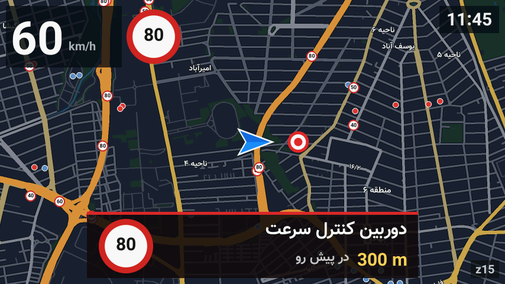 | 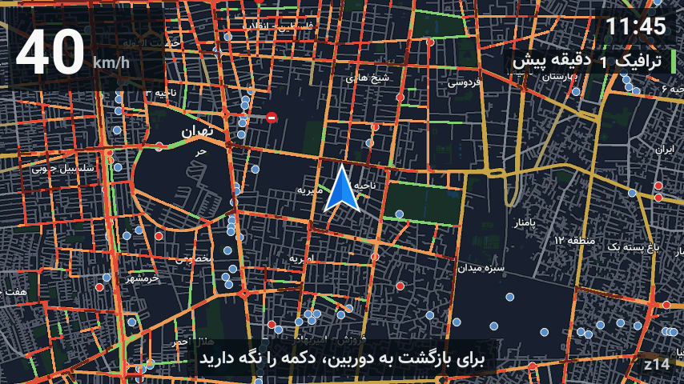 | 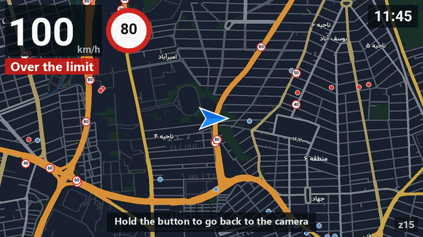 |
| 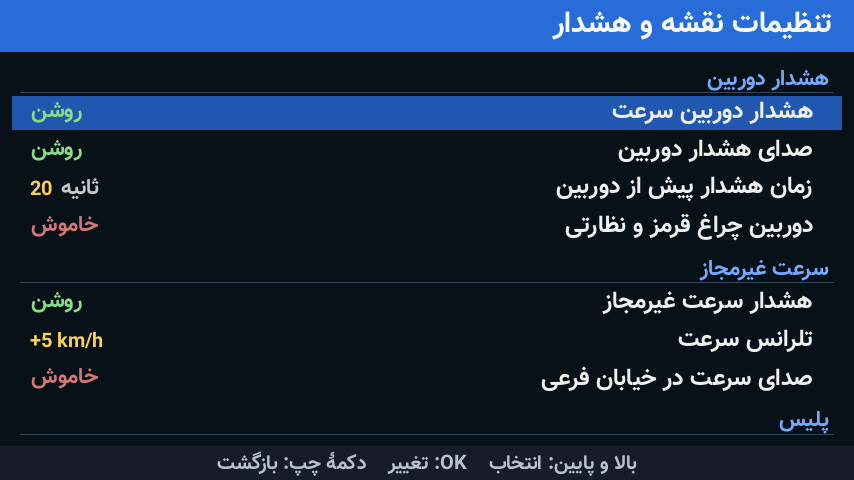 | 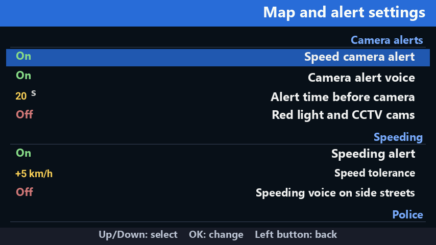 | 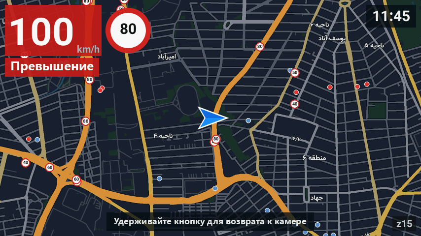 |
| 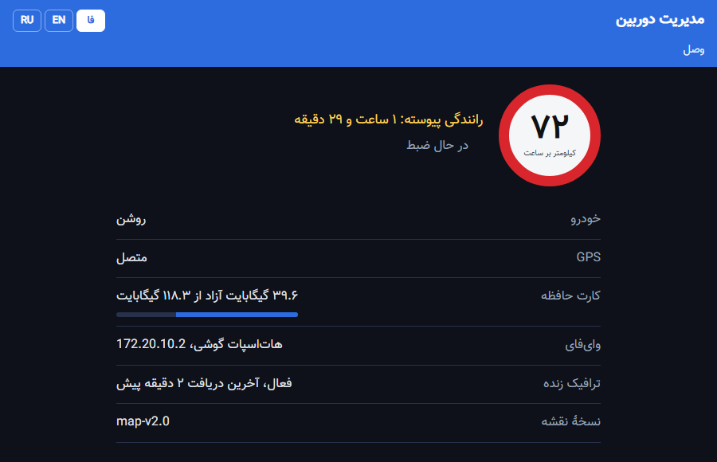 | 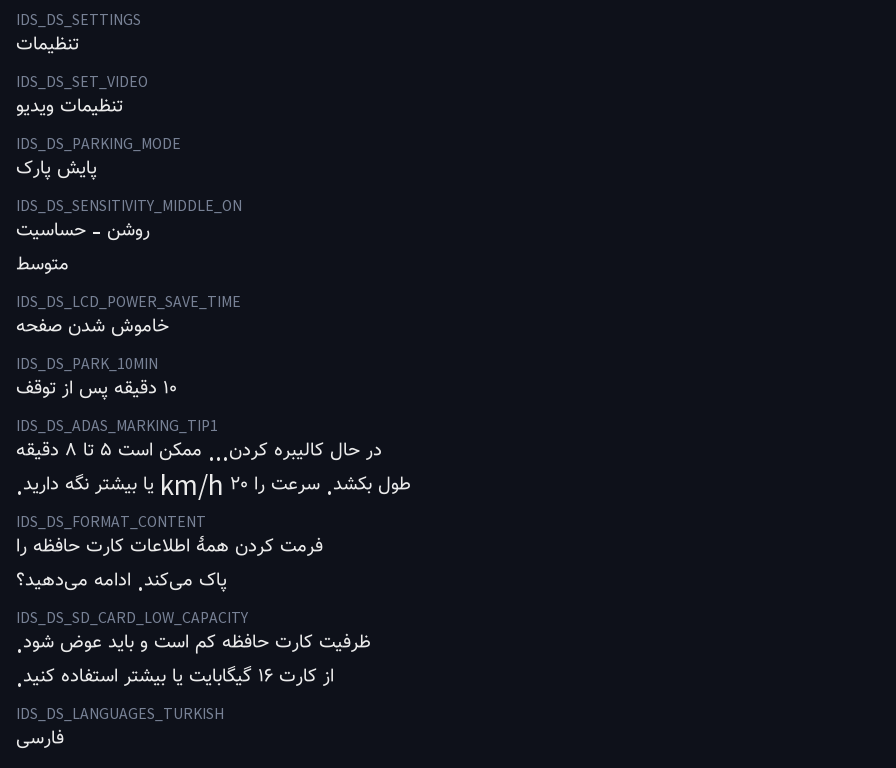 | 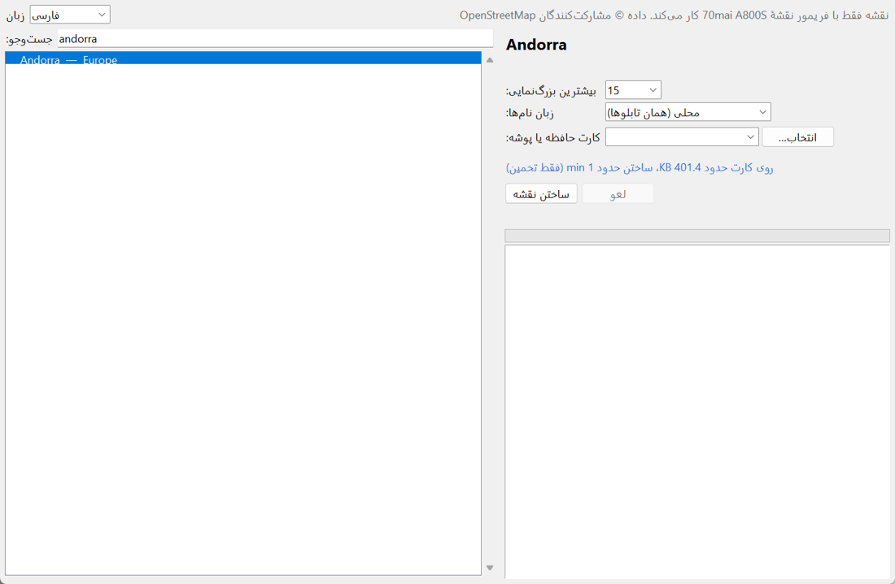 |
| 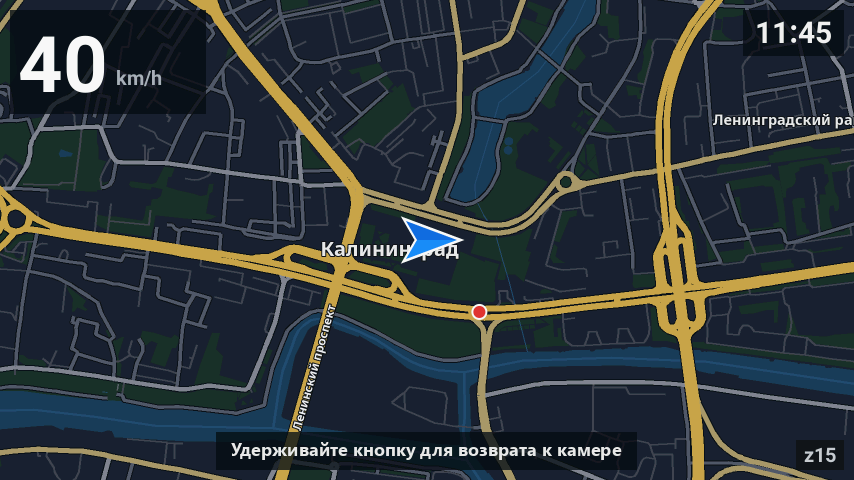 | 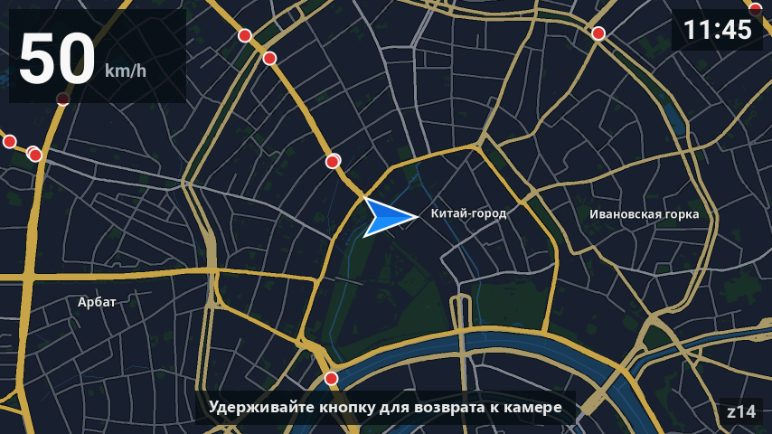 | |

**Download:** [Releases](../../releases/latest) · firmware, ready maps (Iran, Russia), Map Builder for Windows. · **[Donate](#donate)**

---

<a id="fa"></a>
<div dir="rtl">

## فارسی

فریمور غیررسمی برای داشبورد کم **70mai A800S (DR2800)**، ساخته‌شده روی فریمور رسمی **2.2.31ww**. ضبط ویدیو دقیقاً مثل فریمور اصلی است؛ هر چه اضافه شده کنار آن کار می‌کند.

### ⚠️ پیش از نصب بخوانید
- فقط برای **A800S (DR2800)**. روی مدل دیگری فلش نکنید.
- این فریمور رسمی نیست. با مسئولیت خودتان نصب کنید. برای برگشت یا وقتی دوربین بالا نمی‌آید، فایل بازیابی (فریمور رسمی) را فلش کنید؛ بخش «بازیابی» را ببینید.

### تازه‌های v2.4
- **هشدارهای هوشمند رانندگی (ADAS):** کلید اصلی در صفحهٔ وب. در فریمور اصلی این کلید پیش‌فرض خاموش است و تا خاموش باشد، هشدار خروج از خط، نزدیکی به خودروی جلو و حرکت خودروی جلو کار نمی‌کنند، حتی اگر خودشان روشن نشان داده شوند. صفحهٔ وب نشان می‌دهد دوربین کالیبره شده یا نه؛ کالیبره کردن از منوی دوربین.
- **telnet از صفحهٔ وب** روشن و خاموش می‌شود (برای عیب‌یابی؛ پیش‌فرض خاموش).
- **تنظیمات پارک در صفحهٔ وب** اسم و توضیح روشن دارند: «پارک: دوربین تا صبح روشن بماند»، «ضبط ضربه در پارک» و «حساسیت ضربه در رانندگی».
- **لوگو (از v2.3):** ذخیرهٔ لوگو روی بعضی دوربین‌ها خطای `File exists` می‌داد. حالا فایل لوگو درجا بازنویسی می‌شود و نتیجه در `MAP\logs\logo.log` نوشته می‌شود.

### در v2.2
- **وای‌فای:** منوی دوربین، تنظیمات نقشه و صفحهٔ وب حالت وای‌فای را همان لحظه عوض می‌کنند؛ چند فشار پشت سر هم فقط آخرینش اجرا می‌شود و منو دیگر گیر نمی‌کند. وضعیت (در حال تغییر، دنبال هات‌اسپات) در «اطلاعات دستگاه» و صفحهٔ وب.
- **تنظیمات دوربین از صفحهٔ وب** دیگر با خاموش و روشن شدن برنمی‌گردند.
- **بخش لوگو در صفحهٔ وب** دیده می‌شود (گوشی نسخهٔ قدیمی صفحه را از حافظه می‌خواند).
- **ترافیک زنده** دوباره می‌آید: بلد کاشی‌ها را به CDN سوتون منتقل کرده بود.
- **سازندهٔ نقشه** بعد از قطع شدن از همان جا ادامه می‌دهد.

### دانلود (صفحهٔ Releases)
| فایل | چیست |
|---|---|
| `70mai-A800S-map-firmware-v2.4.zip` | فریمور: `FW_DR2800.bin` و `FORCEUPD.txt` |
| `iran-map-1-z5-z15.zip` و `iran-map-2-z16.zip` | نقشهٔ آمادهٔ ایران و دوربین‌های کنترل سرعت (۱۱٬۱۹۶ دوربین) |
| `russia-map-*.zip` | نقشهٔ آمادهٔ روسیه (دوربین‌ها از OpenStreetMap) |
| `70mai-MapBuilder-windows.zip` | برنامهٔ ویندوز برای ساختن نقشهٔ هر کشور |
| `70mai-A800S-official-2.2.31ww-recovery.zip` | فریمور رسمی 2.2.31ww برای بازیابی و برگشت |

### مقایسه با فریمور اصلی
| قابلیت | فریمور اصلی 2.2.31ww | این فریمور |
|---|---|---|
| ضبط ویدیو، ADAS، پایش پارک، اپ 70mai | ✅ | ✅ بدون تغییر |
| نقشهٔ آفلاین تمام‌صفحه روی صفحهٔ دوربین | ❌ | ✅ با نگه داشتن دکمهٔ چپ |
| نقشهٔ هر کشور | ❌ | ✅ با Map Builder ویندوز |
| هشدار دوربین کنترل سرعت | ❌ پایگاه دوربین ندارد | ✅ فقط دوربین‌های جاده و جهت خودتان |
| تابلوی سرعت مجاز و هشدار سرعت غیرمجاز | ❌ | ✅ |
| ترافیک زنده و گزارش پلیس (ایران، از راه هات‌اسپات گوشی) | ❌ | ✅ |
| زوم خودکار با سرعت | ❌ | ✅ |
| صفحهٔ تنظیمات نقشه روی دوربین | ❌ | ✅ ۲۰ گزینه |
| صفحهٔ مدیریت از مرورگر گوشی | ❌ فقط اپ | ✅ وضعیت، تنظیمات، پخش و دانلود ویدیو، لاگ |
| یادآور استراحت | ❌ | ✅ |
| زبان فارسی در منو و پیام‌های صوتی | ❌ | ✅ جای ترکی |
| زبان نقشه و هشدارها جدا از منو | ❌ | ✅ فارسی / English / Русский |
| لوگوی روشن و خاموش شدن دلخواه | ❌ | ✅ هر عکسی، از صفحهٔ وب |
| راه‌اندازی دوباره از منو | ❌ فقط دکمهٔ پاور | ✅ از نقشه و صفحهٔ وب |
| وای‌فای | فقط AP برای اپ | AP یا اتصال به هات‌اسپات گوشی (STA)؛ تغییر از منو، نقشه یا صفحهٔ وب همان لحظه |
| فرمت اجباری کارت وقتی فایل غیرویدیویی زیاد است | ❌ ضبط تا فرمت متوقف می‌شود | ✅ حذف شد؛ پوشهٔ نقشه مشکلی ندارد |
| شروع دوبارهٔ ضبط بعد از پارک طولانی | گاهی شروع نمی‌شود | ✅ نگهبان ضبط |
| telnet روت بدون رمز | ⚠️ همیشه روشن | ✅ خاموش؛ روشن کردن از صفحهٔ وب |
| اسکریپت `autorun_*.sh` از ریشهٔ کارت | ❌ | ✅ موقع روشن شدن اجرا می‌شود |
| لاگ عیب‌یابی روی کارت | ❌ | ✅ `MAP\logs` |

### نصب
1. **فریمور:** zip فریمور را باز کنید و `FW_DR2800.bin` و `FORCEUPD.txt` را در ریشهٔ کارت حافظه بگذارید. دوربین را با برق USB یا فندکی و **بدون زدن دکمه** روشن کنید. صفحهٔ به‌روزرسانی می‌آید و دوربین خودش دوباره روشن می‌شود.
2. **نقشه:** همهٔ zipهای نقشهٔ کشورتان را در ریشهٔ کارت باز کنید تا پوشهٔ `MAP` ساخته شود (`MAP\z5_0.map`، …، `MAP\roads.bin`). اگر جا کم است، فایل‌های بزرگ‌ترین زوم (مثلاً `z16`) را نگذارید.
3. دوربین را روشن کنید. حدود ۲۰ ثانیه بعد نقشه آماده است.

### راهنمای قابلیت‌ها

**نقشه و دکمه‌ها**
- روی تصویر دوربین، **دکمهٔ چپ** (آیکن میکروفون) را حدود یک ثانیه نگه دارید تا نقشه بیاید. دوباره نگه دارید تا تصویر دوربین برگردد.
- روی نقشه: دکمهٔ **دوم** بزرگ‌نمایی، دکمهٔ **سوم** کوچک‌نمایی، دکمهٔ **چهارم (OK)** صفحهٔ تنظیمات.
- روی نقشه: موقعیت و جهت، سرعت، ساعت، نقطهٔ قرمز ضبط، دوربین‌ها (قرمز = سرعت، آبی = نظارتی) و اسم شهرها و خیابان‌ها.
- اگر صفحه خاموش است، اول یک بار دکمه را کوتاه بزنید.

**هشدار دوربین هوشمند**
- فقط دوربین‌هایی که روی همان جاده و در جهت حرکت شما هستند. دوربین جادهٔ کناری یا لاین مخالف هشدار نمی‌دهد.
- فاصلهٔ هشدار با سرعت تنظیم می‌شود: حدود ۲۰ ثانیه پیش از رسیدن (۲۵۰ تا ۸۰۰ متر)، در طول جاده.
- هشدار فقط وقتی نقشه باز است کار می‌کند.

**سرعت مجاز و سرعت غیرمجاز**
- تابلوی گرد کنار سرعت، از محدودیت دوربین پیش رو یا از سرعت مجاز جاده در OpenStreetMap.
- اگر ۳ ثانیه بیش از حد مجاز (به‌اضافهٔ تلرانس) بروید، کادر سرعت قرمز و چشمک‌زن می‌شود و صدای «سرعت غیرمجاز» پخش می‌شود.

**ترافیک زنده و پلیس (فقط ایران)**
- دوربین باید به هات‌اسپات گوشی وصل باشد (پایین‌تر: «وای‌فای»). خیابان‌ها به رنگ ترافیک کشیده می‌شوند، جادهٔ بسته خط‌چین است و گزارش پلیس با صدا اعلام می‌شود.
- در این حالت اپ 70mai وصل نمی‌شود. مصرف اینترنت حدود ۲ مگابایت در ساعت است.

**صفحهٔ تنظیمات نقشه** (روی نقشه دکمهٔ OK؛ بالا/پایین انتخاب، OK تغییر، دکمهٔ چپ برگشت)

| تنظیم | کار | مقدارها |
|---|---|---|
| هشدار دوربین سرعت | روشن یا خاموش کردن هشدار دوربین‌ها | روشن / خاموش |
| صدای هشدار دوربین | فقط تصویر، یا تصویر و صدا | روشن / خاموش |
| زمان هشدار پیش از دوربین | چند ثانیه قبل از رسیدن | ۲۰ / ۳۰ / ۱۰ / ۱۵ ثانیه |
| دوربین چراغ قرمز و نظارتی | هشدار برای دوربین‌های غیر از سرعت | خاموش / روشن |
| هشدار سرعت غیرمجاز | کادر قرمز و صدا | روشن / خاموش |
| تلرانس سرعت | چقدر بالاتر از حد مجاز هشدار بدهد | +۵ / +۱۰ / +۱۵ / ۰ km/h |
| صدای سرعت در خیابان فرعی | صدای سرعت غیرمجاز وقتی محدودیت فقط از نقشه است | خاموش / روشن |
| صدای گزارش پلیس | اعلام صوتی گزارش پلیس | روشن / خاموش |
| فاصلهٔ هشدار پلیس | از چه فاصله‌ای | ۵۰۰ / ۸۰۰ / ۳۰۰ متر |
| زوم شروع | زوم نقشه موقع باز شدن | ۱۲ تا ۱۶ |
| زوم خودکار با سرعت | زیر ۴۰ km/h زوم ۱۶، تا ۸۰ زوم ۱۵، بالاتر ۱۴ | روشن / خاموش |
| نمایش دوربین‌ها روی نقشه | نقطه‌های دوربین | روشن / خاموش |
| ترافیک زنده | رنگ ترافیک روی خیابان‌ها | روشن / خاموش |
| به‌روزرسانی ترافیک | هر چند دقیقه | ۵ / ۱۰ / ۲ دقیقه |
| یادآور استراحت | بعد از چند دقیقه رانندگی پیوسته | ۱۲۰ / ۹۰ / ۱۸۰ / خاموش |
| زبان نقشه و صداها | مثل منوی دوربین، یا یک زبان ثابت | مثل منو / فارسی / English / Русский |
| پایش پارک تمام‌شب | خاموش شدن ۵ دقیقه بعد از پارک، یا تا صبح | خاموش / روشن |
| شروع ضبط بعد از پارک | اگر ضبط خودش شروع نشد، شروعش کند | روشن / خاموش |
| حالت وای‌فای | اپ 70mai یا اینترنت هات‌اسپات | AP / STA (همان لحظه) |
| راه‌اندازی دوباره | ضبط بسته و دوربین دوباره روشن می‌شود | دو بار OK در ۵ ثانیه |
| اطلاعات دستگاه | نسخه، GPS، وای‌فای، ترافیک، دوربین‌ها، حافظه، آدرس صفحهٔ وب | — |

**صفحهٔ مدیریت از مرورگر گوشی**
- به وای‌فای دوربین وصل شوید و `http://192.168.1.1/map/` را باز کنید. در حالت هات‌اسپات، آدرس در «اطلاعات دستگاه» نوشته شده.
- وضعیت (سرعت، ضبط، GPS، کارت، وای‌فای)، همهٔ تنظیمات نقشه، تنظیمات مهم دوربین (با کلید ADAS و تنظیمات پارک)، نام و رمز هات‌اسپات، telnet، پخش و دانلود ویدیوها، لاگ‌ها، لوگو، راه‌اندازی دوباره. زبان با دکمه‌های فا / EN / RU.
- رمز ورود ندارد؛ هر کس به وای‌فای دوربین وصل باشد به آن دسترسی دارد. حذف فایل ندارد.

**یادآور استراحت**
- بعد از ۲ ساعت رانندگی پیوسته (قابل تغییر) پیام و صدای «کمی استراحت کنید»، و هر ۳۰ دقیقه تکرار. ۱۵ دقیقه توقف یعنی استراحت.

**زبان‌ها**
- زبان منو را در تنظیمات دوربین عوض کنید. «فارسی» جای «ترکی» در فهرست است. منو، پیام‌های صوتی دوربین، هشدارها، نقشه و صفحهٔ وب همه با آن عوض می‌شوند.
- با «زبان نقشه و صداها» می‌توانید مثلاً منو را انگلیسی و نقشه و هشدارها را فارسی کنید.

**لوگوی روشن و خاموش شدن**
- صفحهٔ وب ← تنظیمات ← لوگو. هر عکسی از گوشی را انتخاب کنید؛ اندازه، چرخش و قالب خودکار درست می‌شود. «لوگوی پیش‌فرض» لوگوی 70mai را برمی‌گرداند.

**وای‌فای و هات‌اسپات گوشی (`config.txt`)**
- در ریشهٔ کارت فایل `config.txt` بسازید:
  ```
  wifi_mode=STA
  wifi_sta_ssid=نام هات‌اسپات
  wifi_sta_pass=رمز هات‌اسپات
  wifi_sta_band=2.4G
  wifi_sta_time_sync=1
  ```
- آیفون: Personal Hotspot ← Maximize Compatibility روشن. اسم هات‌اسپات بهتر است بدون فاصله و علامت باشد.
- برای برگشت به اپ 70mai: `wifi_mode=AP`، یا از منو / صفحهٔ تنظیمات نقشه.

**تنظیمات پیشرفته (`MAP\mapd.cfg`)**
- `key = 139` دکمهٔ باز کردن نقشه (۱۰۳ دوم، ۱۰۸ سوم)، `zoom = 15`، `alert_s = 20`، `alert_min_m = 250`، `alert_max_m = 800`، `over_kmh = 5`، `over_s = 3`، `live = auto|off`، `live_refresh_s = 300`، `police_alert_m = 500`.
- فایل خالی `MAP\mapd_off`: نقشه کاملاً خاموش. فایل خالی `MAP\live_off`: ترافیک زنده خاموش.

**کارت حافظه**
- دوربین دیگر به‌خاطر پوشهٔ `MAP` فرمت اجباری نمی‌خواهد. اگر خودتان از منو فرمت کنید، `MAP` هم پاک می‌شود و باید دوباره کپی کنید.

**سازندهٔ نقشه (ویندوز)**
- `70mai-MapBuilder.exe` را اجرا کنید (نصب لازم نیست). کشور یا منطقه، بیشترین زوم، زبان نام خیابان‌ها و کارت حافظه را انتخاب کنید و «ساختن نقشه» را بزنید.
- آخرین دادهٔ OpenStreetMap دانلود، نقشه روی کامپیوتر ساخته و در `MAP` کارت نوشته می‌شود. دوربین‌های سرعت از OpenStreetMap می‌آیند.
- کشورهای بزرگ (مثل روسیه) هم ساخته می‌شوند؛ چند ساعت طول می‌کشد و چند ده گیگابایت جای خالی روی کامپیوتر می‌خواهد. اگر کامپیوتر وسط کار خاموش شد، دوباره «ساختن نقشه» را بزنید: زوم‌های تمام‌شده نگه داشته می‌شوند.

**بازیابی و برگشت به فریمور رسمی**
- فایل `70mai-A800S-official-2.2.31ww-recovery.zip` فریمور رسمی 2.2.31ww برای بازیابی است.
- روش: ویدیوهای لازم را بردارید؛ پوشهٔ `MAP`، `config.txt` و `autorun_*.sh` را از کارت پاک کنید، چون فریمور رسمی با بیش از ۵۰۰ مگابایت فایل غیرویدیویی فرمت می‌خواهد (بهتر: کارت را FAT32 فرمت کنید)؛ `FW_DR2800.bin` و `FORCEUPD.txt` را در ریشهٔ کارت بگذارید و دوربین را با برق USB یا فندکی و بدون زدن دکمه روشن کنید.
- حتی وقتی دوربین دیگر بالا نمی‌آید هم کار می‌کند: این فریمور بوت‌لودر و کرنل رسمی را دست نمی‌زند و آپدیت از کارت پیش از سیستم اجرا می‌شود.
- اگر بعدش منو ترکی شد (فارسی جای ترکی بود)، زبان را از منو عوض کنید.

**لاگ و گزارش مشکل**
- `MAP\logs` روی کارت: `mapd_NNN.log` (نقشه و هشدارها)، `live_NNN.log` (ترافیک)، `wifi.log`، `logo.log`. برای گزارش مشکل همین پوشه را بفرستید.

**حمایت:** اگر این پروژه به کارتان آمد، می‌توانید با رمزارز [حمایت کنید](#donate).

</div>

---

<a id="en"></a>

## English

An unofficial firmware for the **70mai A800S (DR2800)** dash cam, built on the official **2.2.31ww**. Video recording is exactly as in the official firmware; everything new runs next to it.

### ⚠️ Read before installing
- **A800S (DR2800) only.** Do not flash it on another model.
- This is not official firmware; install it at your own risk. To go back, or if the camera no longer starts, flash the recovery file (the official firmware); see "Recovery".

### New in v2.4
- **Driver assistance alerts (ADAS):** a main switch on the web page. The official firmware ships with it off, and while it is off the lane departure, forward collision and car-ahead-moved alerts do nothing, even when they show as on. The web page also shows whether the camera is calibrated; calibrate from the camera menu.
- **Telnet from the web page:** turn it on or off (for troubleshooting; off by default).
- **Parking settings on the web page** have clear names and notes: "Parking: keep the camera on all night", "Record bumps while parked" and "Bump sensitivity while driving".
- **Logo (since v2.3):** saving the logo gave `File exists` on some cameras. The logo file is now overwritten in place, and the result goes to `MAP\logs\logo.log`.

### In v2.2
- **Wi-Fi:** the camera menu, the map's settings and the web page switch Wi-Fi at once; a burst of presses applies only the last one and the menu no longer hangs. Status (switching, looking for the hotspot) in Device info and on the web page.
- **Camera settings from the web page** no longer revert after a power cycle.
- **The logo section of the web page** shows (phones kept an old copy of the page).
- **Live traffic** works again: Balad moved its tiles to the Sotoon CDN.
- **Map Builder** continues where it stopped.

### Downloads (Releases page)
| File | What it is |
|---|---|
| `70mai-A800S-map-firmware-v2.4.zip` | The firmware: `FW_DR2800.bin` and `FORCEUPD.txt` |
| `iran-map-1-z5-z15.zip`, `iran-map-2-z16.zip` | Ready map of Iran with its speed cameras (11,196) |
| `russia-map-*.zip` | Ready map of Russia (cameras from OpenStreetMap) |
| `70mai-MapBuilder-windows.zip` | Windows app that builds the map of any country |
| `70mai-A800S-official-2.2.31ww-recovery.zip` | The official 2.2.31ww firmware, for recovery and going back |

### Compared with the official firmware
| Feature | Official 2.2.31ww | This firmware |
|---|---|---|
| Recording, ADAS, parking mode, 70mai app | ✅ | ✅ unchanged |
| Offline full-screen map on the camera screen | ❌ | ✅ hold the left button |
| Map of any country | ❌ | ✅ with the Windows Map Builder |
| Speed-camera alerts | ❌ no camera database | ✅ only cameras on your road and in your direction |
| Speed-limit sign and overspeed warning | ❌ | ✅ |
| Live traffic and police reports (Iran, through a phone hotspot) | ❌ | ✅ |
| Auto zoom by speed | ❌ | ✅ |
| Map settings page on the camera | ❌ | ✅ 20 options |
| Admin page in the phone's browser | ❌ app only | ✅ status, settings, play and download videos, logs |
| Rest reminder | ❌ | ✅ |
| Persian menu and voice prompts | ❌ | ✅ in place of Turkish |
| Map and alert language apart from the menu | ❌ | ✅ Persian / English / Russian |
| Your own power-on and power-off logo | ❌ | ✅ any picture, from the web page |
| Restart from the menu | ❌ power button only | ✅ from the map and the web page |
| Wi-Fi | AP for the app only | AP, or join a phone hotspot (STA); switch from the menu, map or web page at once |
| Forced card format when there are many non-video files | ❌ recording stops until you format | ✅ removed; the map folder is fine |
| Recording restarts after long parking | sometimes it doesn't | ✅ recording guard |
| Root telnet without a password | ⚠️ always on | ✅ off; turn on from the web page |
| `autorun_*.sh` scripts from the card root | ❌ | ✅ run at power-on |
| Diagnostic logs on the card | ❌ | ✅ `MAP\logs` |

### Install
1. **Firmware:** unzip it and put `FW_DR2800.bin` and `FORCEUPD.txt` in the root of the memory card. Power the camera from USB or the car socket **without pressing any button**. The update screen appears and the camera restarts by itself.
2. **Map:** unzip all the map zips of your country into the card root, so you get a `MAP` folder (`MAP\z5_0.map` … `MAP\roads.bin`). Short of space? Leave out the files of the highest zoom (e.g. `z16`).
3. Turn the camera on. The map is ready about 20 seconds later.

### Feature guide

**Map and buttons**
- On the camera view, **hold the left button** (microphone icon) for about a second to open the map. Hold it again to go back.
- On the map: **2nd** button zooms in, **3rd** zooms out, **4th (OK)** opens the settings.
- Shown: position and heading, speed, clock, a red recording dot, cameras (red = speed, blue = surveillance), city and street names.
- If the screen is off, press a button once first.

**Smart camera alerts**
- Only cameras on your road and in your direction; a camera on a side road or the opposite carriageway stays quiet.
- The alert distance follows your speed: about 20 seconds before the camera (250-800 m), measured along the road.
- Alerts work while the map is open.

**Speed limit and overspeed**
- A round sign next to your speed, from the camera ahead or from the road's OpenStreetMap limit.
- 3 seconds above the limit (plus the tolerance): the speed box turns red and flashes and an "overspeed" voice plays.

**Live traffic and police (Iran only)**
- The camera must be on a phone hotspot (see "Wi-Fi"). Streets are coloured by traffic, closed roads are dashed, police reports are announced.
- The 70mai app can't connect in this mode. About 2 MB of data an hour.

**Map settings page** (OK on the map; up/down choose, OK change, left button back)

| Setting | What it does | Values |
|---|---|---|
| Speed camera alert | Camera alerts on or off | on / off |
| Camera alert voice | Picture only, or picture and voice | on / off |
| Alert time before camera | Seconds before you reach it | 20 / 30 / 10 / 15 s |
| Red-light and surveillance cameras | Alerts for non-speed cameras too | off / on |
| Overspeed alert | Red box and voice | on / off |
| Speed tolerance | How far over the limit before the alert | +5 / +10 / +15 / 0 km/h |
| Overspeed voice on minor roads | Voice when the limit comes only from the map | off / on |
| Police report voice | Spoken police reports | on / off |
| Police alert distance | How far ahead | 500 / 800 / 300 m |
| Start zoom | Zoom when the map opens | 12-16 |
| Auto zoom by speed | below 40 km/h z16, up to 80 z15, faster z14 | on / off |
| Show cameras on the map | Camera dots | on / off |
| Live traffic | Traffic colours on the streets | on / off |
| Traffic refresh | Every N minutes | 5 / 10 / 2 min |
| Rest reminder | After N minutes of driving | 120 / 90 / 180 / off |
| Map and voice language | Like the camera menu, or a fixed language | like menu / Persian / English / Russian |
| All-night parking monitor | Power off 5 min after parking, or stay on | off / on |
| Start recording after parking | Starts recording if it didn't start by itself | on / off |
| Wi-Fi mode | 70mai app or hotspot internet | AP / STA (at once) |
| Restart | Closes the recording and restarts the camera | OK twice within 5 s |
| Device info | Version, GPS, Wi-Fi, traffic, cameras, memory, web page address | — |

**Admin page in your phone's browser**
- Join the camera's Wi-Fi and open `http://192.168.1.1/map/`. On a hotspot, the address is in "Device info".
- Status (speed, recording, GPS, card, Wi-Fi), all map settings, the main camera settings (with the ADAS switch and parking settings), hotspot name and password, telnet, play and download videos, logs, logo, restart. Language: the fa / EN / RU buttons.
- No password: anyone on the camera's Wi-Fi can use it. It can't delete files.

**Rest reminder**
- After 2 hours of continuous driving (adjustable) a message and "take a break" voice, repeated every 30 minutes. A 15-minute stop counts as a break.

**Languages**
- Change the menu language in the camera settings ("Persian" sits where Turkish was). Menu, voice prompts, alerts, map and web page all follow it.
- "Map and voice language" lets you have, say, an English menu with Persian map and alerts.

**Power-on and power-off logo**
- Web page → Settings → Logo. Pick any picture; size, rotation and format are fixed for you. "Default logo" brings back the 70mai logo.

**Wi-Fi and a phone hotspot (`config.txt`)**
- Create `config.txt` in the card root:
  ```
  wifi_mode=STA
  wifi_sta_ssid=hotspot name
  wifi_sta_pass=hotspot password
  wifi_sta_band=2.4G
  wifi_sta_time_sync=1
  ```
- iPhone: Personal Hotspot → turn on Maximize Compatibility. A hotspot name without spaces or symbols is safest.
- Back to the 70mai app: `wifi_mode=AP`, or from the menu / map settings.

**Advanced settings (`MAP\mapd.cfg`)**
- `key = 139` button that opens the map (103 2nd, 108 3rd), `zoom = 15`, `alert_s = 20`, `alert_min_m = 250`, `alert_max_m = 800`, `over_kmh = 5`, `over_s = 3`, `live = auto|off`, `live_refresh_s = 300`, `police_alert_m = 500`.
- Empty file `MAP\mapd_off`: map fully off. Empty file `MAP\live_off`: live traffic off.

**Memory card**
- The `MAP` folder no longer triggers a forced format. If you format from the menu yourself, `MAP` is erased too; copy it again.

**Map Builder (Windows)**
- Run `70mai-MapBuilder.exe` (no install). Pick a country or region, the highest zoom, the street-name language and the memory card, then "Build the map".
- It downloads the latest OpenStreetMap data, draws the map on the PC and writes it to `MAP` on the card. Speed cameras come from OpenStreetMap.
- Big countries (like Russia) work too; they take hours and tens of GB of free space on the PC. If the PC turns off part way, press "Build the map" again: finished zoom levels are kept.

**Recovery and going back to the official firmware**
- `70mai-A800S-official-2.2.31ww-recovery.zip` is the official 2.2.31ww firmware for recovery.
- How: save the videos you need; delete `MAP`, `config.txt` and `autorun_*.sh` from the card, because the official firmware asks to format when there are over 500 MB of non-video files (better: format the card as FAT32); put `FW_DR2800.bin` and `FORCEUPD.txt` in the card root and power the camera from USB or the car socket without pressing any button.
- It works even when the camera no longer starts: this firmware leaves the official boot loader and kernel untouched, and the card update runs before the system.
- If the menu is in Turkish afterwards (Persian used that slot), change the language in the menu.

**Logs and reporting a problem**
- `MAP\logs` on the card: `mapd_NNN.log` (map and alerts), `live_NNN.log` (traffic), `wifi.log`, `logo.log`. Send this folder with a problem report.

**Support:** if this project is useful to you, you can [donate in crypto](#donate).

---

<a id="ru"></a>

## Русский

Неофициальная прошивка для видеорегистратора **70mai A800S (DR2800)** на основе официальной **2.2.31ww**. Запись видео такая же, как в официальной прошивке; всё новое работает рядом с ней.

### ⚠️ Прочтите перед установкой
- **Только для A800S (DR2800).** Не прошивайте другую модель.
- Прошивка неофициальная; устанавливайте на свой риск. Чтобы вернуться, или если камера больше не запускается, прошейте файл восстановления (официальная прошивка); см. «Восстановление».

### Новое в v2.4
- **Помощь водителю (ADAS):** главный переключатель на странице управления. В официальной прошивке он выключен, и пока он выключен, предупреждения о выезде из полосы, о сближении и о начале движения впереди не работают, даже если показаны включёнными. Страница также показывает, откалибрована ли камера; калибровка — в меню камеры.
- **Telnet со страницы управления:** включение и выключение (для диагностики; по умолчанию выключен).
- **Настройки парковки на странице управления** получили понятные названия и пояснения: «Парковка: камера включена всю ночь», «Запись ударов на стоянке» и «Чувствительность к ударам в движении».
- **Логотип (с v2.3):** сохранение логотипа на некоторых камерах давало `File exists`. Теперь файл логотипа перезаписывается на месте, а результат пишется в `MAP\logs\logo.log`.

### В v2.2
- **Wi-Fi:** меню камеры, настройки карты и страница управления переключают Wi-Fi сразу; из серии нажатий выполняется только последнее, меню больше не зависает. Состояние (переключение, поиск точки доступа) — в «Сведениях» и на странице.
- **Настройки камеры со страницы управления** больше не сбрасываются после выключения.
- **Раздел логотипа** на странице управления виден (телефоны держали старую копию страницы).
- **Пробки** снова работают: Balad перенёс тайлы на CDN Sotoon.
- **Map Builder** продолжает с места остановки.

### Загрузки (страница Releases)
| Файл | Что это |
|---|---|
| `70mai-A800S-map-firmware-v2.4.zip` | Прошивка: `FW_DR2800.bin` и `FORCEUPD.txt` |
| `iran-map-1-z5-z15.zip`, `iran-map-2-z16.zip` | Готовая карта Ирана с камерами (11 196) |
| `russia-map-*.zip` | Готовая карта России (камеры из OpenStreetMap) |
| `70mai-MapBuilder-windows.zip` | Программа для Windows: карта любой страны |
| `70mai-A800S-official-2.2.31ww-recovery.zip` | Официальная прошивка 2.2.31ww для восстановления и возврата |

### Сравнение с официальной прошивкой
| Функция | Официальная 2.2.31ww | Эта прошивка |
|---|---|---|
| Запись, ADAS, парковочный режим, приложение 70mai | ✅ | ✅ без изменений |
| Офлайн-карта на весь экран камеры | ❌ | ✅ удерживайте левую кнопку |
| Карта любой страны | ❌ | ✅ с Map Builder для Windows |
| Оповещения о камерах скорости | ❌ нет базы камер | ✅ только камеры на вашей дороге и в вашем направлении |
| Знак ограничения скорости и предупреждение о превышении | ❌ | ✅ |
| Пробки и сообщения о полиции (Иран, через точку доступа телефона) | ❌ | ✅ |
| Автомасштаб по скорости | ❌ | ✅ |
| Страница настроек карты на камере | ❌ | ✅ 20 настроек |
| Страница управления в браузере телефона | ❌ только приложение | ✅ состояние, настройки, просмотр и загрузка видео, журналы |
| Напоминание об отдыхе | ❌ | ✅ |
| Персидское меню и голосовые сообщения | ❌ | ✅ вместо турецкого |
| Язык карты и оповещений отдельно от меню | ❌ | ✅ персидский / английский / русский |
| Свой логотип включения и выключения | ❌ | ✅ любая картинка, со страницы управления |
| Перезагрузка из меню | ❌ только кнопкой питания | ✅ с карты и со страницы управления |
| Wi-Fi | только точка доступа для приложения | точка доступа или подключение к телефону (STA); переключение из меню, карты или страницы сразу |
| Принудительное форматирование карты при большом объёме не-видео файлов | ❌ запись стоит до форматирования | ✅ убрано; папка карты не мешает |
| Запись после долгой стоянки | иногда не начинается | ✅ страж записи |
| Root telnet без пароля | ⚠️ всегда включён | ✅ выключен; включается со страницы управления |
| Скрипты `autorun_*.sh` из корня карты памяти | ❌ | ✅ запускаются при включении |
| Журналы для диагностики на карте памяти | ❌ | ✅ `MAP\logs` |

### Установка
1. **Прошивка:** распакуйте архив и положите `FW_DR2800.bin` и `FORCEUPD.txt` в корень карты памяти. Включите камеру от USB или прикуривателя **не нажимая кнопок**. Появится экран обновления, и камера перезапустится сама.
2. **Карта:** распакуйте все архивы карты вашей страны в корень карты памяти, чтобы появилась папка `MAP` (`MAP\z5_0.map` … `MAP\roads.bin`). Мало места? Не копируйте файлы самого крупного масштаба (например, `z16`).
3. Включите камеру. Карта готова примерно через 20 секунд.

### Руководство по функциям

**Карта и кнопки**
- На изображении камеры **удерживайте левую кнопку** (значок микрофона) около секунды, чтобы открыть карту. Ещё раз, чтобы вернуться.
- На карте: **2-я** кнопка приближает, **3-я** отдаляет, **4-я (OK)** открывает настройки.
- На экране: положение и направление, скорость, часы, красная точка записи, камеры (красные = скорость, синие = наблюдение), названия городов и улиц.
- Если экран погас, сначала коротко нажмите кнопку.

**Умные оповещения о камерах**
- Только камеры на вашей дороге и в вашем направлении; камера на соседней улице или встречной полосе молчит.
- Расстояние оповещения зависит от скорости: примерно за 20 секунд до камеры (250-800 м), по дороге.
- Оповещения работают, пока открыта карта.

**Ограничение скорости и превышение**
- Круглый знак рядом со скоростью: от камеры впереди или из ограничения дороги в OpenStreetMap.
- 3 секунды выше ограничения (плюс допуск): поле скорости мигает красным и звучит «превышение скорости».

**Пробки и полиция (только Иран)**
- Камера должна быть подключена к точке доступа телефона (см. «Wi-Fi»). Улицы окрашены по пробкам, перекрытые дороги пунктиром, сообщения о полиции озвучиваются.
- Приложение 70mai в этом режиме не подключается. Около 2 МБ трафика в час.

**Страница настроек карты** (OK на карте; вверх/вниз выбор, OK изменить, левая кнопка назад)

| Настройка | Что делает | Значения |
|---|---|---|
| Оповещение о камерах | Включить или выключить оповещения | вкл / выкл |
| Голос оповещения | Только картинка или картинка и голос | вкл / выкл |
| Время оповещения | За сколько секунд до камеры | 20 / 30 / 10 / 15 с |
| Камеры на светофорах и наблюдения | Оповещать и о них | выкл / вкл |
| Предупреждение о превышении | Красное поле и голос | вкл / выкл |
| Допуск скорости | Насколько выше ограничения | +5 / +10 / +15 / 0 км/ч |
| Голос о превышении на второстепенных дорогах | Когда ограничение только из карты | выкл / вкл |
| Голос о полиции | Озвучивать сообщения о полиции | вкл / выкл |
| Расстояние оповещения о полиции | За сколько метров | 500 / 800 / 300 м |
| Начальный масштаб | Масштаб при открытии карты | 12-16 |
| Автомасштаб по скорости | до 40 км/ч z16, до 80 z15, быстрее z14 | вкл / выкл |
| Камеры на карте | Точки камер | вкл / выкл |
| Пробки | Цвет пробок на улицах | вкл / выкл |
| Обновление пробок | Каждые N минут | 5 / 10 / 2 мин |
| Напоминание об отдыхе | Через N минут езды | 120 / 90 / 180 / выкл |
| Язык карты и голоса | Как в меню камеры или постоянный | как в меню / персидский / английский / русский |
| Парковочный режим всю ночь | Выключение через 5 минут стоянки или работа всю ночь | выкл / вкл |
| Запуск записи после стоянки | Запускает запись, если она не началась сама | вкл / выкл |
| Режим Wi-Fi | Приложение 70mai или интернет телефона | AP / STA (сразу) |
| Перезагрузка | Закрывает запись и перезапускает камеру | OK дважды за 5 с |
| Сведения об устройстве | Версия, GPS, Wi-Fi, пробки, камеры, память, адрес страницы | — |

**Страница управления в браузере телефона**
- Подключитесь к Wi-Fi камеры и откройте `http://192.168.1.1/map/`. В режиме точки доступа телефона адрес указан в «Сведениях об устройстве».
- Состояние (скорость, запись, GPS, карта памяти, Wi-Fi), все настройки карты, основные настройки камеры (с переключателем ADAS и настройками парковки), имя и пароль точки доступа, telnet, просмотр и загрузка видео, журналы, логотип, перезагрузка. Язык: кнопки fa / EN / RU.
- Пароля нет: пользоваться может любой, кто подключён к Wi-Fi камеры. Удалять файлы нельзя.

**Напоминание об отдыхе**
- После 2 часов непрерывной езды (настраивается) сообщение и голос «сделайте перерыв», повтор каждые 30 минут. Остановка на 15 минут считается отдыхом.

**Языки**
- Язык меню меняется в настройках камеры («персидский» стоит на месте турецкого). Меню, голосовые сообщения, оповещения, карта и страница управления следуют ему.
- «Язык карты и голоса» позволяет, например, английское меню и персидские карту и оповещения.

**Логотип включения и выключения**
- Страница управления → Настройки → Логотип. Выберите любую картинку; размер, поворот и формат подгоняются сами. «Логотип по умолчанию» возвращает логотип 70mai.

**Wi-Fi и точка доступа телефона (`config.txt`)**
- Создайте `config.txt` в корне карты памяти:
  ```
  wifi_mode=STA
  wifi_sta_ssid=имя точки доступа
  wifi_sta_pass=пароль точки доступа
  wifi_sta_band=2.4G
  wifi_sta_time_sync=1
  ```
- iPhone: Режим модема → включите «Максимальная совместимость». Имя точки доступа лучше без пробелов и символов.
- Вернуться к приложению 70mai: `wifi_mode=AP`, или в меню / настройках карты.

**Расширенные настройки (`MAP\mapd.cfg`)**
- `key = 139` кнопка открытия карты (103 2-я, 108 3-я), `zoom = 15`, `alert_s = 20`, `alert_min_m = 250`, `alert_max_m = 800`, `over_kmh = 5`, `over_s = 3`, `live = auto|off`, `live_refresh_s = 300`, `police_alert_m = 500`.
- Пустой файл `MAP\mapd_off`: карта полностью выключена. Пустой файл `MAP\live_off`: пробки выключены.

**Карта памяти**
- Папка `MAP` больше не вызывает принудительное форматирование. Если вы сами отформатируете карту из меню, `MAP` тоже удалится; скопируйте её снова.

**Map Builder (Windows)**
- Запустите `70mai-MapBuilder.exe` (установка не нужна). Выберите страну или регион, наибольший масштаб, язык названий улиц и карту памяти, затем «Собрать карту».
- Программа загружает свежие данные OpenStreetMap, рисует карту на ПК и записывает её в `MAP` на карте памяти. Камеры скорости берутся из OpenStreetMap.
- Большие страны (например, Россия) тоже собираются; это занимает часы и десятки ГБ свободного места на ПК. Если ПК выключился посреди работы, снова нажмите «Собрать карту»: готовые масштабы сохраняются.

**Восстановление и возврат к официальной прошивке**
- `70mai-A800S-official-2.2.31ww-recovery.zip` — официальная прошивка 2.2.31ww для восстановления.
- Как: сохраните нужные видео; удалите с карты `MAP`, `config.txt` и `autorun_*.sh`, потому что официальная прошивка требует форматирования при более чем 500 МБ не-видео файлов (лучше отформатировать карту в FAT32); положите `FW_DR2800.bin` и `FORCEUPD.txt` в корень и включите камеру от USB или прикуривателя, не нажимая кнопок.
- Работает, даже если камера больше не запускается: эта прошивка не трогает официальные загрузчик и ядро, а обновление с карты идёт до загрузки системы.
- Если после этого меню стало турецким (персидский был на его месте), смените язык в меню.

**Журналы и сообщение о проблеме**
- `MAP\logs` на карте памяти: `mapd_NNN.log` (карта и оповещения), `live_NNN.log` (пробки), `wifi.log`, `logo.log`. Пришлите эту папку вместе с описанием проблемы.

**Поддержка:** если проект вам пригодился, можно [поддержать его криптовалютой](#donate).

---

<a id="donate"></a>

## Donate · حمایت · Поддержать

If this firmware or the Map Builder is useful to you, a donation helps keep it going. Thank you!
<div dir="rtl">اگر این فریمور یا سازندهٔ نقشه به کارتان آمد، حمایت شما به ادامهٔ کار کمک می‌کند. ممنون!</div>
Если прошивка или Map Builder вам пригодились, поддержка поможет развивать проект. Спасибо!

| Currency | Network | Address |
|---|---|---|
| USDT | TRON (TRC20) | `TLmPzcn57Row4WEo8MM5U898eD5Wmjosur` |
| TRX | TRON | `TLmPzcn57Row4WEo8MM5U898eD5Wmjosur` |
| TON (Gram) | TON | `UQDajG9zCNak_fytodSOqsIOT_1U-faYB3mWatu2wJBA67tT` |
| BTC | Bitcoin | `bc1qcuhkp8ymdsxrgj7yp0xz9l246yf0t395nvhxvz` |

Send USDT only on the **TRON (TRC20)** network; other networks will lose the coins.
<div dir="rtl">USDT را فقط روی شبکهٔ <b>TRON (TRC20)</b> بفرستید؛ روی شبکهٔ دیگر از دست می‌رود.</div>
USDT отправляйте только в сети **TRON (TRC20)**; в другой сети монеты будут потеряны.

---

## Credits and licences
- Map data © [OpenStreetMap](https://www.openstreetmap.org/copyright) contributors, ODbL; extracts from [Geofabrik](https://download.geofabrik.de/).
- Live traffic in Iran: [Balad](https://balad.ir/).
- Fonts: [Vazir](https://github.com/rastikerdar/vazir-font) and [Noto Sans](https://notofonts.github.io/) (SIL Open Font License).
- TLS: [Mbed TLS](https://github.com/Mbed-TLS/mbedtls) 3.6.2 (Apache-2.0).
- Base: the official 70mai A800S firmware 2.2.31ww, with boot scripts from the [Kitchen](https://github.com/boba-nopasaran-dr2800/Kitchen) custom firmware (`config.txt`, STA Wi-Fi, autorun). 70mai is a trademark of its owner; this project is not affiliated with 70mai.
